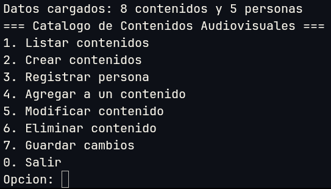
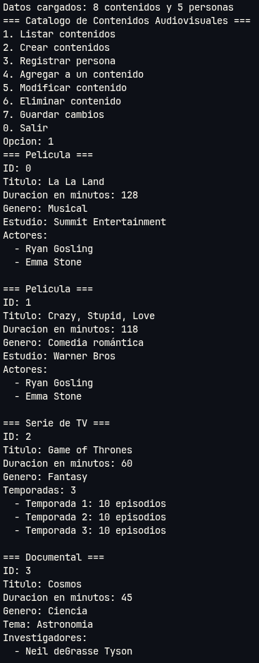
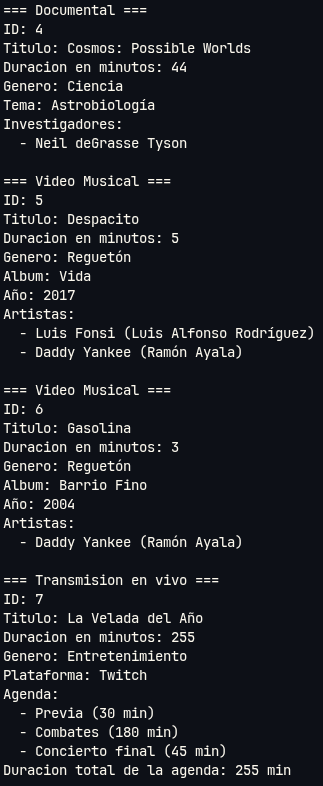
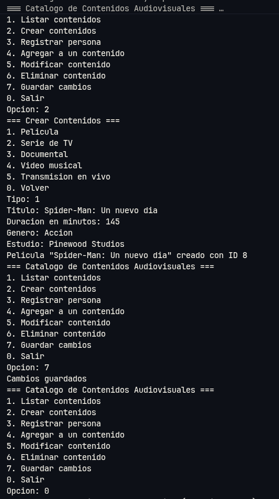
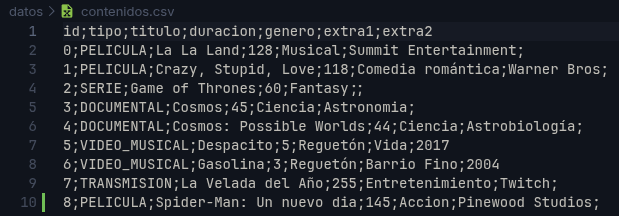
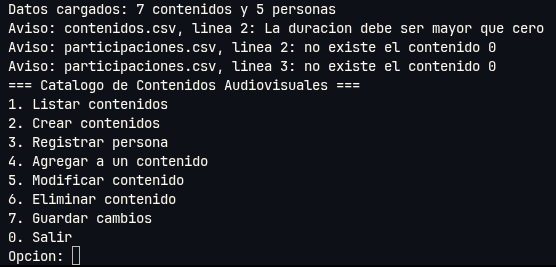
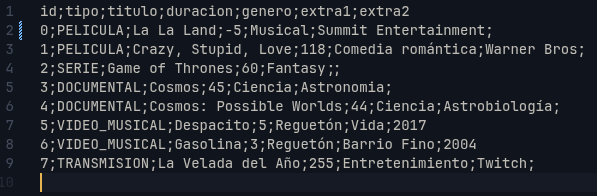
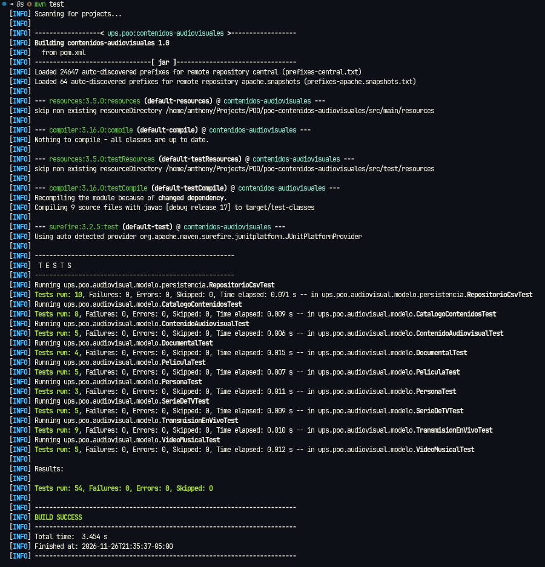
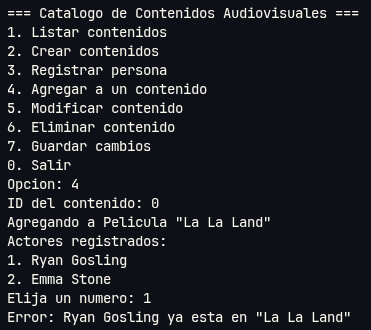
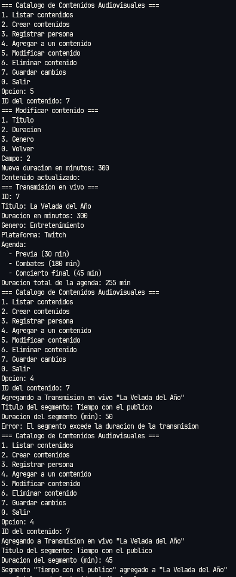

# Contenidos Audiovisuales — POO Unidad 4

Aplicación de consola en Java para administrar un catálogo de contenidos audiovisuales (películas, series, documentales, videos musicales y transmisiones en vivo) y las personas que participan en ellos. Proyecto de la asignatura **Programación Orientada a Objetos** (Universidad Politécnica Salesiana), Unidad 4: Código Limpio.

Esta versión mejora el sistema de la Unidad 2 con persistencia en archivos CSV, refactorización, principios SOLID y pruebas unitarias. La versión anterior se conserva en la etiqueta [`unidad-2`](https://github.com/nzanthony/poo-contenidos-audiovisuales/tree/unidad-2).

## Objetivos

- Guardar y cargar el catálogo en archivos CSV.
- Refactorizar el código aplicando prácticas de código limpio: nombres descriptivos, métodos pequeños, sin duplicación y comentarios útiles.
- Aplicar los principios SOLID.
- Mantener la separación entre Modelo, Vista y Controlador.
- Verificar el modelo y la persistencia con pruebas unitarias en JUnit 5.

## Estructura del proyecto

```
poo-contenidos-audiovisuales/
├── pom.xml                         Java 17, JUnit 5 y Surefire
├── datos/                          Archivos CSV con el catálogo
├── docs/
│   ├── diagrama-clases.md          Diagramas UML en Mermaid
│   └── img/                        Capturas del sistema
└── src/
    ├── main/java/ups/poo/audiovisual/
    │   ├── app/
    │   │   └── Main.java           Crea las dependencias y arranca el controlador
    │   ├── controlador/
    │   │   └── ControladorContenidos.java
    │   ├── modelo/
    │   │   ├── ContenidoAudiovisual.java, Pelicula.java, SerieDeTV.java,
    │   │   │   Documental.java, VideoMusical.java, TransmisionEnVivo.java
    │   │   ├── Persona.java, Actor.java, Investigador.java, Artista.java
    │   │   ├── Temporada.java, Segmento.java
    │   │   ├── Participantes.java  Lista de personas de un contenido
    │   │   ├── Validacion.java     Reglas comunes de validación
    │   │   ├── CatalogoContenidos.java
    │   │   └── persistencia/
    │   │       ├── RepositorioContenidos.java   Interfaz
    │   │       └── RepositorioCsv.java          Implementación con CSV
    │   └── vista/
    │       └── VistaConsola.java
    └── test/java/ups/poo/audiovisual/modelo/
        ├── CatalogoContenidosTest.java, ContenidoAudiovisualTest.java, PersonaTest.java,
        │   PeliculaTest.java, SerieDeTVTest.java, DocumentalTest.java,
        │   VideoMusicalTest.java, TransmisionEnVivoTest.java
        └── persistencia/
            └── RepositorioCsvTest.java
```

| Capa | Responsabilidad |
|---|---|
| **Modelo** | Clases del dominio, reglas de validación, catálogo con la asignación de IDs y persistencia en CSV. No imprime ni lee del teclado. |
| **Vista** | Muestra los menús, los contenidos y los mensajes, y lee los datos del usuario con validación de formato. |
| **Controlador** | Recibe la opción elegida, pide los datos a la vista, invoca al modelo y al repositorio, y maneja los errores de carga y guardado. |

El diagrama de clases completo está en [`docs/diagrama-clases.md`](docs/diagrama-clases.md).

## Cambios respecto a la Unidad 2

### 1. Archivos CSV

El catálogo se guarda en cinco archivos de la carpeta `datos/`, separados por punto y coma (`;`) y codificados en UTF-8. Cada contenido y cada persona tiene un ID explícito que funciona como clave, y las relaciones se guardan en archivos aparte que hacen referencia a esos IDs:

| Archivo | Columnas | Contenido |
|---|---|---|
| `contenidos.csv` | `id;tipo;titulo;duracion;genero;extra1;extra2` | Un contenido por fila. Las columnas `extra` guardan el dato propio de cada tipo (estudio, tema, álbum y año, plataforma). |
| `personas.csv` | `id;tipo;nombre;nacionalidad;edad;extra` | Actores, investigadores y artistas. `extra` guarda la especialidad o el nombre artístico. |
| `participaciones.csv` | `idContenido;idPersona` | Qué persona participa en qué contenido. |
| `temporadas.csv` | `idSerie;numero;episodios` | Temporadas de cada serie. |
| `segmentos.csv` | `idTransmision;titulo;duracion` | Agenda de cada transmisión en vivo. |

- **Carga:** el programa lee los archivos al iniciar, primero contenidos y personas y después las relaciones, que los buscan por ID.
- **Guardado:** con la opción 7, o al salir si el usuario lo confirma. Si la carpeta no existe, se crea.
- **Manejo de errores:**
  - Un archivo que no existe se omite con un aviso.
  - Una fila mal formada (columnas faltantes, números inválidos, tipo desconocido, ID repetido o datos que rechaza el modelo) se omite con un aviso que indica el archivo y la línea, y el resto se carga con normalidad.
  - Si un archivo no se puede leer, por ejemplo porque no está en UTF-8, el programa inicia con el catálogo vacío y bloquea el guardado para no sobrescribir los datos originales.
  - Si se omitieron filas al cargar, el programa pide confirmación antes de guardar, porque esas filas desaparecerían de los archivos.
  - Un `;` escrito dentro de un texto se reemplaza por una coma al guardar para no desplazar las columnas.

### 2. Refactorización y código limpio

- **Sin duplicación:**
  - La clase genérica `Participantes<T extends Persona>` reemplaza las tres listas que repetían la misma lógica en `Pelicula`, `Documental` y `VideoMusical`.
  - `Validacion` centraliza las reglas de texto obligatorio, número positivo y rango para no repetirlas en cada constructor y setter.
- **Nombres descriptivos:**
  - `calcularDuracion` pasa a llamarse `calcularDuracionAgenda`.
  - Se agregaron `getMinutosDisponibles` y `existeTemporada` para que las condiciones se lean como frases.
- **Métodos con una sola tarea:**
  - `Temporada` y `Segmento` tienen su propio `toString`.
  - `SerieDeTV` y `TransmisionEnVivo` construyen su texto con `StringBuilder`.
- **IDs sin estado global:** el contador estático de `ContenidoAudiovisual` se eliminó. Ahora el catálogo asigna los IDs, lo que permite pruebas repetibles y conservar los IDs al cargar desde archivos.
- **Integridad del modelo:** los constructores y setters rechazan datos inválidos con `IllegalArgumentException`, de modo que no se pueden crear objetos inconsistentes ni desde el menú ni desde un CSV editado a mano.

### 3. Principios SOLID

| Principio | Aplicación |
|---|---|
| **S** — Responsabilidad única | `CatalogoContenidos` almacena los datos y asigna IDs, `RepositorioCsv` lee y escribe archivos, `Validacion` define las reglas de datos y `ControladorContenidos` solo coordina. Antes, el controlador guardaba las listas y asignaba los IDs. |
| **O** — Abierto/cerrado | `getPersonas(Class<T>)` filtra cualquier subtipo de `Persona` sin agregar un método por tipo. El método protegido `esDuracionValida` permite que una subclase agregue reglas sin modificar `ContenidoAudiovisual`. |
| **L** — Sustitución de Liskov | El setter de duración se reemplazó por `cambiarDuracion`, que devuelve `false` si la duración no es válida para ese tipo. `TransmisionEnVivo` amplía la regla para no quedar por debajo de su agenda sin romper el contrato de la clase base, así que el controlador trata a todos los contenidos igual. |
| **I** — Segregación de interfaces | `RepositorioContenidos` declara solo las operaciones que el controlador necesita: cargar, guardar y consultar los avisos de la carga. |
| **D** — Inversión de dependencias | El controlador depende de la interfaz `RepositorioContenidos` y no de `RepositorioCsv`. `Main` crea la implementación concreta y la inyecta por el constructor. |

### 4. MVC

- El controlador ya no contiene datos: los obtiene del catálogo y los persiste mediante el repositorio.
- `Main` ya no carga datos de ejemplo; solo arma las dependencias.
- La persistencia forma parte del modelo, en el subpaquete `modelo.persistencia`, porque trabaja con los datos y no con la interacción con el usuario.

### 5. Pruebas unitarias

Las pruebas están en `src/test/java` y usan JUnit 5. Cubren casos normales, valores límite y casos excepcionales:

| Clase de prueba | Pruebas | Qué verifica |
|---|---|---|
| `CatalogoContenidosTest` | 8 | IDs consecutivos, que no se reutilicen al eliminar, búsqueda por ID, filtro por tipo y listas de solo lectura |
| `ContenidoAudiovisualTest` | 5 | `cambiarDuracion` con valores válidos e inválidos, y que el constructor y los setters rechacen datos vacíos o no positivos |
| `PersonaTest` | 3 | Límites de la edad (0 y 120), textos vacíos y setters que conservan el valor anterior si el nuevo es inválido |
| `PeliculaTest` | 5 | Agregar actores, rechazar duplicados y nulos, lista de solo lectura y texto del contenido |
| `DocumentalTest` | 4 | Agregar investigadores, rechazar duplicados y nulos, y texto del contenido |
| `VideoMusicalTest` | 5 | Agregar artistas, rechazar duplicados y nulos, nombre artístico y límites del año (1900 y 2100) |
| `SerieDeTVTest` | 5 | Temporadas nuevas, números repetidos y lista de solo lectura |
| `TransmisionEnVivoTest` | 9 | Segmentos que caben, que llenan el tiempo exacto o que lo exceden, desbordamiento con `Integer.MAX_VALUE` y duración menor que la agenda |
| `RepositorioCsvTest` | 10 | Guardar y volver a cargar sin pérdida, conservar tipos y relaciones, continuar la numeración, reemplazo del `;` en los textos, carpeta vacía, filas mal formadas o con datos inválidos, tipo desconocido y participación con una persona inexistente |

En total son 54 pruebas. `RepositorioCsvTest` usa `@TempDir`, por lo que cada prueba trabaja en una carpeta temporal y no modifica los archivos de `datos/`.

## Requisitos

- JDK 17 o superior.
- Maven 3.6 o superior para ejecutar las pruebas desde la terminal. También se pueden ejecutar desde un IDE con soporte para Maven (Eclipse, IntelliJ IDEA, NetBeans o VS Code con el Extension Pack for Java).
- Conexión a internet la primera vez, para que Maven descargue JUnit y sus plugins.

## Cómo clonar y ejecutar

```bash
git clone https://github.com/nzanthony/poo-contenidos-audiovisuales.git
cd poo-contenidos-audiovisuales
```

> **Importante:** el programa busca la carpeta `datos/` en el directorio desde el que se ejecuta. Debe ejecutarse desde la raíz del proyecto; si no, inicia con el catálogo vacío y muestra avisos de archivos inexistentes.

**VS Code**

1. Abrir la carpeta `poo-contenidos-audiovisuales` como raíz del workspace, no una carpeta superior.
2. Abrir `Main.java` y pulsar `Run` sobre el método `main`.

**Eclipse**

1. `File > Import > Maven > Existing Maven Projects` y seleccionar la carpeta clonada.
2. Si aparecen errores, clic derecho en el proyecto > `Maven > Update Project` (Alt+F5).
3. Clic derecho en `Main.java` > `Run As > Java Application`. Eclipse usa la raíz del proyecto como directorio de trabajo.

**Terminal con Maven**

```bash
mvn compile
java -cp target/classes ups.poo.audiovisual.app.Main
```

**Terminal sin Maven**

```bash
javac -d out $(find src/main/java -name "*.java")
java -cp out ups.poo.audiovisual.app.Main
```

## Cómo ejecutar las pruebas

Desde la raíz del proyecto:

```bash
mvn test
```

Al final se muestra el resumen `Tests run: 54, Failures: 0, Errors: 0, Skipped: 0` y `BUILD SUCCESS`. Para ejecutar una sola clase:

```bash
mvn test -Dtest=RepositorioCsvTest
```

En VS Code también se pueden ejecutar desde la vista **Testing** (ícono de matraz), y en Eclipse con clic derecho en `src/test/java` > `Run As > JUnit Test`.

## Uso

Al iniciar, el programa carga los archivos de `datos/` y muestra cuántos contenidos y personas leyó, junto con los avisos de la carga si los hay. Después aparece el menú principal:

| Opción | Acción |
|---|---|
| 1 | Mostrar todos los contenidos |
| 2 | Crear un contenido de cualquiera de los cinco tipos |
| 3 | Registrar un actor, investigador o artista |
| 4 | Agregar personas, temporadas o segmentos a un contenido |
| 5 | Modificar título, duración o género |
| 6 | Eliminar un contenido |
| 7 | Guardar los cambios en los archivos CSV |
| 0 | Salir, con la opción de guardar antes |

Si el usuario pide guardar al salir y el guardado no se completa, el programa vuelve al menú para no perder los cambios.

## Limitaciones conocidas

- Se pueden registrar dos personas distintas con el mismo nombre.
- Los cinco archivos se escriben uno tras otro; si ocurre un error a la mitad del guardado, pueden quedar archivos de versiones distintas.
- Los archivos CSV editados a mano deben guardarse en UTF-8 y con `;` como separador.

## Capturas

**Carga de datos y menú principal**



**Listado de contenidos**





**Guardado y carga:**




**Fila inválida en un CSV:**




**Pruebas unitarias**



## Validaciones

**Persona repetida en un mismo contenido**



**Segmentos de una transmisión**



## Autor

Anthony Narvaez — Ingeniería de Software, Universidad Politécnica Salesiana.
