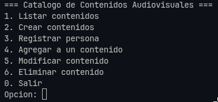
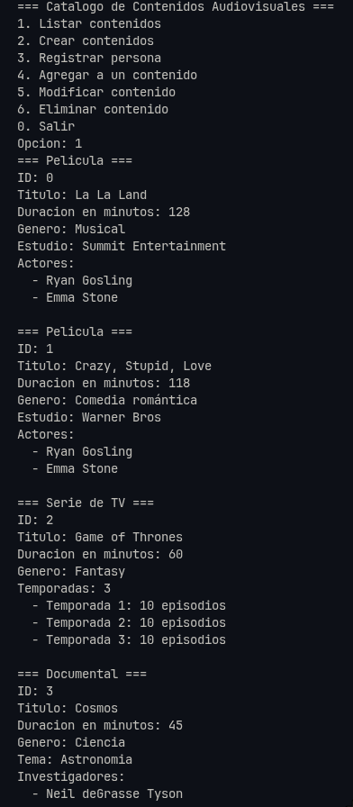
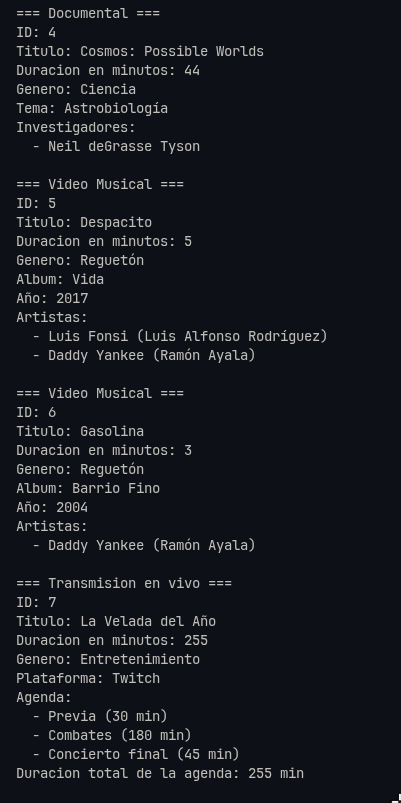
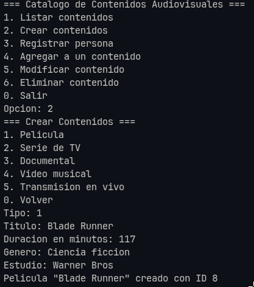
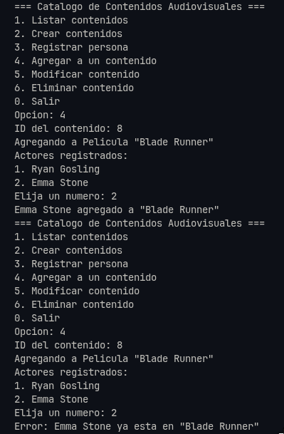
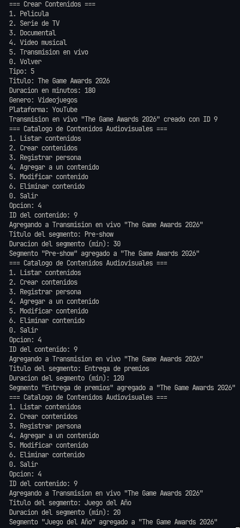
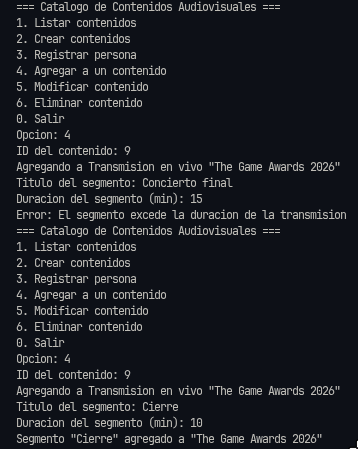

# Contenidos Audiovisuales — POO Unidad 2

Proyecto de la asignatura **Programación Orientada a Objetos** (Universidad Politécnica Salesiana). Amplía el sistema base de contenidos audiovisuales de la Unidad 1 con nuevas clases, relaciones entre objetos y un menú de consola organizado con el patrón MVC.

Basado en el repositorio del curso [CS-Programacion-Orientada-Objetos/poo_unidad1](https://github.com/CS-Programacion-Orientada-Objetos/poo_unidad1).

## Objetivos

- Ampliar el modelo con las clases `Actor`, `Temporada` e `Investigador`, aplicando asociación, composición y agregación.
- Añadir dos nuevos tipos de contenido: `VideoMusical` y `TransmisionEnVivo`, cada uno con su propia relación.
- Representar el diseño en un diagrama de clases UML.
- Construir un sistema funcional que permita crear y manipular objetos de todas las clases.
- Organizar el código con el patrón MVC y la estructura estándar de Maven.

## Estructura del proyecto

```
poo-contenidos-audiovisuales/
├── pom.xml
├── docs/
│   ├── diagrama-clases.md
│   └── img/
└── src/main/java/ups/poo/audiovisual/
    ├── app/           Main (punto de entrada y datos de ejemplo)
    ├── controlador/   ControladorContenidos
    ├── modelo/        Clases del dominio
    └── vista/         VistaConsola
```

## Clases nuevas

| Clase | Relación | Descripción |
|---|---|---|
| `Persona` | Herencia | Clase abstracta con nombre, nacionalidad y edad. Superclase de `Actor`, `Investigador` y `Artista`. |
| `Actor` | Asociación con `Pelicula` | Un actor existe por sí mismo y puede participar en varias películas. |
| `Temporada` | Composición con `SerieDeTV` | Solo la serie puede crear sus temporadas (constructor de paquete); no existen fuera de ella. |
| `Investigador` | Agregación con `Documental` | El documental agrupa investigadores que existen de forma independiente. |
| `VideoMusical` | Subclase de `ContenidoAudiovisual` | Contenido con álbum y año de lanzamiento. |
| `Artista` | Asociación con `VideoMusical` | Persona con nombre artístico; puede aparecer en varios videos. |
| `TransmisionEnVivo` | Subclase de `ContenidoAudiovisual` | Contenido con plataforma y una agenda de segmentos. |
| `Segmento` | Composición con `TransmisionEnVivo` | Bloque de la agenda; solo la transmisión puede crearlo. |

El diagrama de clases completo está en [`docs/diagrama-clases.md`](docs/diagrama-clases.md).

## Requisitos

- JDK 17 o superior.
- Un IDE con soporte para Maven (Eclipse, IntelliJ IDEA, NetBeans o VS Code con el Extension Pack for Java).
- Conexión a internet la primera vez que se importa el proyecto, para que Maven descargue sus plugins.

## Cómo clonar y ejecutar

```bash
git clone https://github.com/nzanthony/poo-contenidos-audiovisuales.git
```

**Eclipse**

1. `File > Import > Maven > Existing Maven Projects` y seleccionar la carpeta clonada.
2. Si aparecen errores, clic derecho en el proyecto > `Maven > Update Project` (Alt+F5).
3. Clic derecho en `Main.java` > `Run As > Java Application`.

**VS Code**

1. Abrir la carpeta clonada como raíz del workspace.
2. Abrir `Main.java` y pulsar `Run` sobre el método `main`.

**Terminal (sin IDE)**

```bash
cd poo-contenidos-audiovisuales
javac -d out $(find src/main/java -name "*.java")
java -cp out ups.poo.audiovisual.app.Main
```

## Uso

Al iniciar, el programa carga datos de ejemplo (películas, una serie, documentales, videos musicales y una transmisión en vivo) y muestra el menú principal:

| Opción | Acción |
|---|---|
| 1 | Mostrar todos los contenidos |
| 2 | Crear un contenido de cualquiera de los cinco tipos |
| 3 | Registrar un actor, investigador o artista |
| 4 | Agregar personas, temporadas o segmentos a un contenido |
| 5 | Modificar título, duración o género |
| 6 | Eliminar un contenido |
| 0 | Salir |

## Mejoras adicionales

- **Patrón MVC:** el modelo no imprime nada; la vista maneja la entrada y salida y el controlador coordina.
- **Estructura Maven:** el proyecto se puede abrir en cualquier IDE sin depender de archivos de configuración de uno en particular.
- **Superclase `Persona`:** evita repetir atributos en `Actor`, `Investigador` y `Artista`.
- **Polimorfismo con `toString()`:** cada tipo de contenido se describe a sí mismo, sin `if` por tipo en la vista.
- **Encapsulamiento de listas:** los getters devuelven copias inmutables (`List.copyOf`), así las listas solo cambian mediante los métodos `agregar...`.
- **Validación de entrada:** los números se leen con rango y manejo de errores; los textos no pueden quedar vacíos.
- **Integridad de datos:** no se permite agregar dos veces la misma persona ni repetir un número de temporada, y una transmisión no acepta segmentos que excedan su duración ni puede acortarse por debajo de su agenda.

## Limitaciones conocidas

- Los datos se guardan solo en memoria y se pierden al cerrar el programa.
- Se pueden registrar dos personas distintas con el mismo nombre.

## Capturas

**Menú principal**



**Listado de contenidos**





**Creación de un contenido**



## Validaciones

**Validacion de persona duplicada**



**Validacion de segmentos**





## Autor

Anthony Narvaez — Ingeniería de Software, Universidad Politécnica Salesiana.